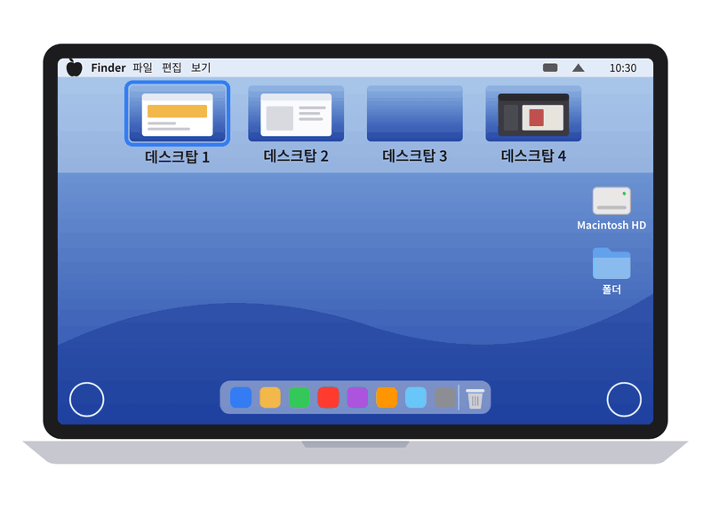
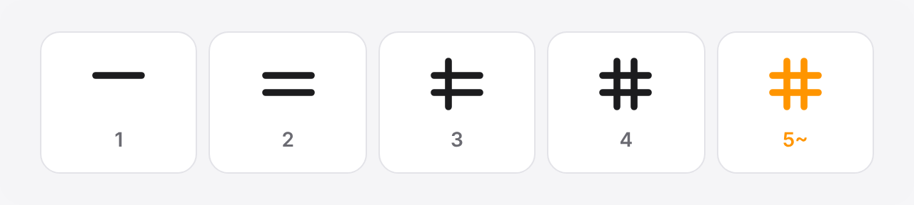
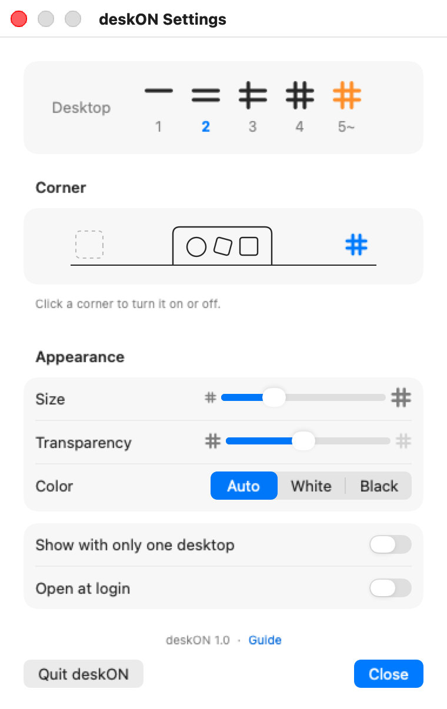

# deskON 데스크온

> 코딩을 전혀 모르던 30년 차 한국의 맥 유저가
> 늘 필요로 했던 것을 Claude Code를 만나
> 반나절 만에 드디어 갖게 되다.
>
> A Korean Mac user of 30 years who knew nothing about coding
> finally got the tool they had always needed,
> in half a day, with Claude Code.

화면 모서리의 # 하나로, 지금 몇 번째 데스크탑인지 바로 알 수 있는 작은 맥 유틸입니다.
A tiny Mac utility that shows which desktop you're on with a single # in the corner.

소개: https://deskon.arapshow.net

## 왜 만들었나 · Why

맥에서 데스크탑(Spaces)을 여러 개 띄워 놓고 쓰는데, 몇 번 넘기다 보면 지금 몇 번째인지 헷갈렸습니다.
Mission Control을 매번 열기는 싫고, 그냥 구석을 힐끗 보고 바로 알고 싶었어요.
메뉴 막대에 숫자를 띄우는 앱은 있었지만, 저는 Dock 양옆에 비어 있는 공간이 늘 아까웠습니다.
그 자리를 쓰는 게 바로 저의 맥 앱 데뷔작 deskON입니다.
별 기능 없는 초단순한 앱이지만, 쓰다가 없으면 꽤 불편할 겁니다. 그만큼 효과는 강력합니다. ㅎㅎ

I use several desktops (Spaces) on my Mac, and after a few swipes I'd lose track of where I was.
I didn't want to open Mission Control every time. I just wanted to glance at a corner and know.
Apps like WhichSpace and Spaceman put the number in the menu bar, but the empty space on either side of the Dock always felt wasted to me.
Putting that space to use became deskON, my debut Mac app.
It's dead simple and barely does anything, but once you're used to it, you'll miss it when it's gone. That's how strong the effect is. :)

## 읽는 법 · How to read

막대가 하나씩 늘어 #이 완성됩니다. 데스크탑이 5개를 넘으면 주황색 #이 뜹니다. 
One bar per desktop until the # is complete. Five or more? You get an orange #.

## 조용히, 구석에서 · Quiet, in the corner

- 모든 데스크탑과 전체화면 앱 위에 늘 보입니다. 
  Always visible, on every desktop and over full-screen apps.
- 메뉴 막대나 Dock에 아이콘을 늘리지 않습니다. 
  No extra icon in the menu bar or the Dock.
- 구석의 #을 누르면 설정과 종료 메뉴가 열립니다. 
  Click the # for Settings and Quit.

## 설정 · Settings

- **Desktop**: 지금 데스크탑 번호가 파랗게 표시됩니다. 
  Your current desktop is shown in blue.
- **Corner**: 왼쪽·오른쪽 구석을 눌러 켜고 끕니다. 둘 다 켤 수도 있습니다. 
  Click a corner to turn it on or off, or use both.
- **Size · Transparency**: 곁눈질로 보일 만큼만 맞춥니다. 
  Just enough to catch from the corner of your eye.
- **Color**: 바탕화면에 맞춰 흰색·검정을 자동으로 고릅니다(Auto · White · Black). 
  Auto-picks white or black to match your wallpaper.
- **Show with only one desktop**: 데스크탑이 하나뿐일 때도 보일지 고릅니다. 
  Choose whether to show the # when you have just one desktop.
- **Open at login**: 맥을 켤 때 함께 켜집니다. 
  Starts with your Mac.
- **Check for updates**: 30일에 한 번 새 버전 번호만 확인합니다. 
  Checks for a new version number once every 30 days.

 

## 다운로드 · Download

[Releases](https://github.com/arapshow/deskon-mac/releases/latest)에서 `deskON-버전.dmg`를 받거나, 소개 페이지에서 받으세요.
Get `deskON-version.dmg` from [Releases](https://github.com/arapshow/deskon-mac/releases/latest) or the website.

처음 열 때는 맥이 한 번 막습니다(Apple 서명이 없는 무료 앱). 시스템 설정 → 개인정보 보호 및 보안 → **그래도 열기**.
The first launch is blocked once (free, unsigned app): System Settings → Privacy & Security → **Open Anyway**.

macOS 13 이상 · Apple 실리콘과 Intel · macOS 13 or later · Apple silicon and Intel

## 알아 둘 점 · Good to know

- 지금 데스크탑 번호는 Apple이 공개하지 않은 방법으로 읽습니다. 그래서 나중에 macOS가 바뀌면 안 될 수도 있습니다. 
  deskON reads the current desktop number through an undocumented macOS API, so a future macOS update could break it.
- 무료이고 계정도 필요 없습니다. 써 보시고 어색한 점은 [Issues](https://github.com/arapshow/deskon-mac/issues)에 남겨 주세요. 
  Free, no account. If something feels off, let me know in [Issues](https://github.com/arapshow/deskon-mac/issues).
- 직접 만들려면 맥에서 `deskON 만들기.command`를 더블클릭하세요(Xcode 명령줄 도구 필요). Swift와 AppKit만 씁니다. 
  To build it yourself, double-click `deskON 만들기.command` on a Mac (needs the Xcode command line tools). Plain Swift and AppKit.
